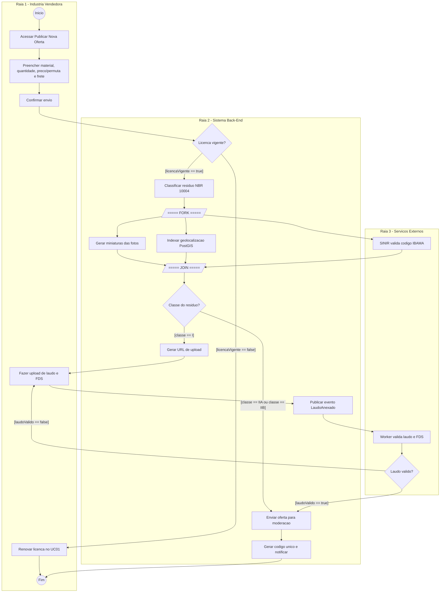

# APS 3 — Publicar Oferta de Sobra Industrial

Projeto: Marketplace B2B de Sobras Industriais (Grupo BTM)
Componente: Catálogo de Sobras
Funcionalidade crítica: Publicar oferta com classificação NBR 10004 e laudo/FDS para Classe I (UC03, UC04 e UC05)
Entidade principal: Oferta
Aluno: João Gabriel Portella

 1. Sobre a funcionalidade

Essa é basicamente a porta de entrada do marketplace. Se a indústria não consegue publicar a sobra dela direito, o resto do sistema nem tem o que mostrar. Só que não dá pra deixar qualquer um publicar qualquer coisa, porque resíduo industrial tem lei por trás (PNRS e NBR 10004). Por isso o fluxo tem três partes que se encaixam:

- UC03 – Publicar Oferta: a vendedora preenche os dados do lote (material, quantidade, preço ou permuta, frete CIF/FOB).
- UC04 – Classificar Resíduo (include): sempre acontece. O sistema enquadra o material na NBR 10004 (Classe I, IIA ou IIB) e confere o código IBAMA no SINIR.
- UC05 – Anexar Laudo e FDS (extend): só entra em ação se o resíduo for Classe I (perigoso). Aí o laudo e a FDS viram obrigatórios.

O ponto mais delicado é o laudo. Ele é um arquivo pesado e a validação dele demora, então é melhor processar essa parte de forma assíncrona, com fila de mensagens.

2. Operações públicas usadas (contrato com o Diagrama de Classes)

Pra manter a regra de consistência, toda mensagem do diagrama de sequência bate com uma operação desta lista:

| Classe / Interface | Operações públicas |
| --- | --- |
| OfertaController | + publicarOferta(dto: NovaOfertaDTO): OfertaCriadaDTO |
| OfertaService | + publicar(dto: NovaOfertaDTO, empresaId: Long): OfertaCriadaDTO |
| Empresa | + obterLicencaAtiva(): LicencaAmbiental |
| LicencaAmbiental | + isVigente(): Boolean |
| ClassificacaoService | + classificar(materialId: Long): ClassificacaoDTO |
| Material | + isResiduoPerigoso(): Boolean |
| SinirClient | + validarCodigoIbama(codigo: String): ResultadoIbamaDTO |
| LaudoStorage | + gerarUrlUpload(ofertaId: Long): UploadUrlDTO |
| Oferta | + anexarLaudo(url: String): Void · + enviarParaModeracao(): Void · + aprovar(): Void · + rejeitar(motivo: String): Void · + publicar(): Void · + pausar(): Void · + encerrar(): Void |
| EventBroker | + publicarEvento(evento: LaudoAnexadoEvent): Void |
| ValidadorLaudoWorker | + consumir(evento: LaudoAnexadoEvent): Void |
| NotificacaoService | + notificar(empresaId: Long, msg: String): Void |

## 3. Diagramas

### 3.1 Diagrama de Sequência

### 3.2 Diagrama de Atividades com Raias
(conteúdo de docs/diagrams/atividades.mmd)

### 3.3 Máquina de Estados da Oferta
(conteúdo de docs/diagrams/estados.mmd)

### 3.4 C4 Nível 2 — Contêineres
Código em `docs/architecture/workspace.dsl` (C4-PlantUML).

### 3.5 ADR
Ver `docs/architecture/adr-0001.md`.

## 4. Como os modelos conversam entre si

- A checagem de licença (`isVigente()`) aparece na sequência, vira o primeiro nó de decisão nas atividades e é a guarda `[licencaVigente]` na máquina de estados.
- O `alt` de Classe I na sequência é o mesmo desvio do diagrama de atividades e a mesma guarda `[classeI]` nos estados.
- O fork/join das atividades (validar IBAMA, gerar miniaturas das fotos e indexar geolocalização ao mesmo tempo) corresponde às chamadas paralelas e assíncronas da sequência.
- Uma oferta Classe I nunca vai direto pra `Ativa` sem passar por `AguardandoLaudo`. Isso impede que alguém publique resíduo perigoso sem documentação, ou seja, evita estado corrompido.
